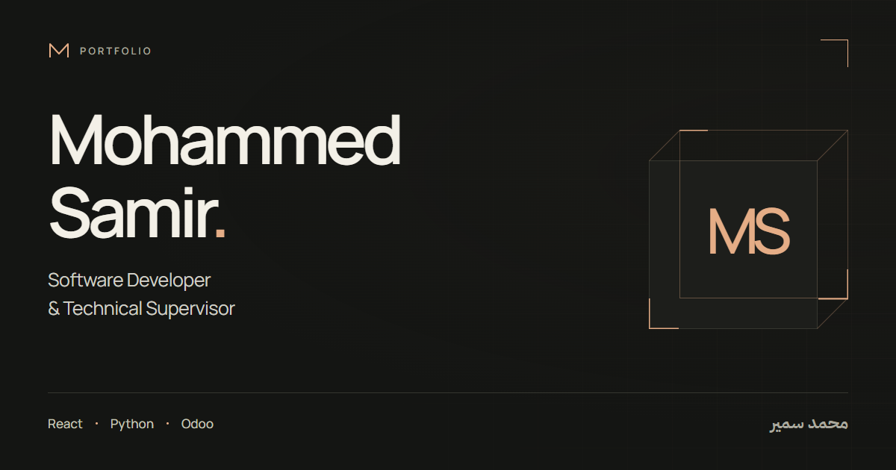

# Mohammed Samir — Portfolio

**Software Developer & Technical Supervisor** · Sakaka, Saudi Arabia

[Visit the portfolio](https://mohammed-samir-portfolio.vercel.app/) · [LinkedIn](https://www.linkedin.com/in/mohammed-samir-13657a2ba/) · [Email](mailto:moh.samir2572976@gmail.com)

[](https://mohammed-samir-portfolio.vercel.app/)

A bilingual personal portfolio presenting my work in web development, Odoo ERP, and technical supervision. Built with React and Vite, with a responsive layout and a shared visual identity across Arabic and English.

[Desktop preview](docs/screenshots/desktop-dark.png) · [Arabic mobile preview](docs/screenshots/mobile-arabic.png)

## Inside the portfolio

- English and Arabic content with LTR/RTL layouts.
- Light and dark appearances, with saved language and appearance preferences.
- Project case studies explaining the challenge, implementation decisions, and delivered functionality.
- A timetable preview generated by the actual scheduling engine using synthetic demonstration data.
- Experience, skills, education, direct contact links, and downloadable one-page professional profiles in both languages.
- Keyboard navigation, visible focus states, accessible dialogs, and reduced-motion support.
- Locally hosted fonts and a static production build.

## Selected projects

### Sakaka Institute Timetable

An Arabic scheduling application for coordinating trainers, sections, rooms, and weekly teaching requirements. It supports automatic generation, conflict validation, shared saving, staff permissions, manual/Excel input, and Excel/PDF export.

[Open the application](https://sakaka-institute-timetable.onrender.com/) — an approved account is required. The portfolio's generated timetable uses synthetic data and does not expose institute records.

### Real Estate Management — Odoo

A private custom module covering property records, sales and rentals, user permissions, search filters, and reports. The portfolio describes the work and includes a conceptual illustration; this repository contains no Odoo module source or public demo.

## Stack

React 19 · Vite 8 · JavaScript · CSS · Manrope · IBM Plex Sans Arabic

The portfolio is a static application. It does not require a database or application server.

## Run locally

Install Node.js and npm, then run:

```sh
npm ci
npm run dev
```

Open the local address printed by Vite. On Windows, `START-PREVIEW.cmd` also prepares the dependencies and opens the preview.

## Validate and build

```sh
npm run lint
npm run build
npm run preview
```

The production output is generated in `dist/`.

## Project structure

```text
src/
  components/          Interface sections and shared components
  data/content.js     English and Arabic content
  data/timetable-demo.json
                      Saved output from the scheduling engine
  index.css           Shared visual system and responsive styles
public/
  fonts/              Locally hosted fonts and their licenses
  social-preview.png  Portfolio share card
  *.pdf               English and Arabic professional profiles
```

## Contact

[moh.samir2572976@gmail.com](mailto:moh.samir2572976@gmail.com) · [WhatsApp](https://wa.me/966563916760) · [GitHub](https://github.com/mohammed111001) · [LinkedIn](https://www.linkedin.com/in/mohammed-samir-13657a2ba/)
